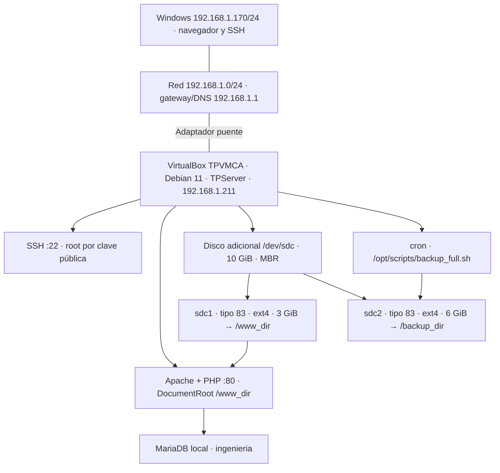

# Trabajo práctico integrador — Computación Aplicada

## Integrantes

- Tomas Aldao
- Catalina Longhi
- Santiago Sequin
- Josefina (apellido a completar)

Fecha de entrega: a completar por el grupo.

## Estado

La VM de la materia está importada como **TPVMCA**, con Debian 11 y hostname **TPServer**. Se verificaron SSH desde Windows, HTTP 200 con 15 registros, particiones y persistencia después de reiniciar. Las pruebas de backup y restauración pasaron.

**Pendientes:** incorporar el `logo.png` original de Blackboard; completar el apellido de Josefina y la fecha; dar acceso al docente a este repositorio privado; confirmar las interpretaciones de `/proc` y las exclusiones documentadas de las exportaciones. La página funciona, pero el logo todavía está ausente.

## Infraestructura

| Elemento | Configuración verificada |
|---|---|
| VM | VirtualBox, TPVMCA, 2 CPU, 2 GB RAM |
| Sistema | Debian 11, kernel 5.10.0-30-amd64, hostname TPServer |
| Máquina física | Windows, 192.168.1.170/24 al verificar |
| Red | Puente sobre Realtek PCIe GbE Family Controller |
| Interfaz VM | enp0s3, MAC 08:00:27:55:9b:cc |
| IP estática | 192.168.1.211 |
| Máscara | 255.255.255.0 |
| Gateway y DNS | 192.168.1.1 |
| SSH | Puerto 22; root por clave pública; sin contraseña por SSH |
| Web | Apache, PHP 7.4.33 y mysqli; puerto 80 |
| Base de datos | MariaDB; base ingenieria; 15 notas |
| Hora | America/Argentina/Buenos_Aires; NTP activo |

La IP fija conserva la dirección inicialmente asignada por DHCP. **No hay reserva en el router**, porque el grupo no tiene acceso a su configuración. La conexión funciona, pero no se puede garantizar que DHCP nunca asigne esa dirección a otro equipo. Comprobarla antes de la defensa y al cambiar de red.



## Procedimiento realizado

1. Se ensamblaron los nueve RAR y se importó `TPVMCA.ova`. Se conservaron los discos originales: `/dev/sda` para `/` y swap; `/dev/sdb1` para `/home`.
2. Se agregó temporalmente `init=/bin/bash` a la línea del kernel en GRUB. En recuperación se remontó `/` con escritura y se estableció la contraseña root exigida (`palermo`). Se verificó el inicio de sesión normal. El cambio de GRUB no es persistente.
3. Se configuró `TPServer` en `/etc/hostname` y `/etc/hosts`.
4. Se corrigió el adaptador puente y se escribió la IP fija en `/etc/network/interfaces`. Los nombres válidos de ifupdown son `address`, `netmask` y `gateway`, en minúsculas.
5. Se corrigieron los repositorios de APT: `cdn2-fastly.debian.org` no resolvía. Se configuraron los repositorios oficiales de Debian 11. La entrada de seguridad devolvió errores 404 al descargar paquetes y se retiró para completar la instalación. El original quedó como `sources.list.tp-original`. Se mantuvo la versión de la VM de la materia; esto no acredita una actualización completa de seguridad.
6. Se instalaron OpenSSH, Apache, PHP/mysqli, MariaDB y cron. La clave pública proporcionada se autorizó en `/root/.ssh/authorized_keys` (directorio 700, archivo 600). `/etc/ssh/sshd_config.d/tp.conf` permite root por clave y deshabilita contraseña por SSH.
7. Se agregó un tercer disco de 10 GiB y se verificó su número de serie. Se crearon dos particiones primarias tipo 83, de 3 GiB y 6 GiB, dejando aproximadamente 1 GiB sin asignar. Ambas se formatearon en ext4 y se agregaron a `/etc/fstab` por UUID.
8. Se importó `db.sql` y se copió `index.php` a `/www_dir`. `000-default.conf` define `DocumentRoot /www_dir` y permite el acceso con `Require all granted`. Se agregó `ServerName TPServer` como configuración habilitada de Apache. El logo original sigue pendiente.
9. Se instaló `/opt/scripts/backup_full.sh` con permisos 750 y se programó `/etc/cron.d/tp-backup`.
10. Se reinició Debian y se comprobaron red, montajes, servicios y web desde Windows.

UUID de los montajes nuevos:

```text
UUID=4ce9f02d-a276-464c-ac16-35508b5a923d /www_dir ext4 defaults 0 2
UUID=0fbdef43-b252-45ad-9e87-51f8e6e760ef /backup_dir ext4 defaults 0 2
```

## Acceso y pruebas

Abrir **http://192.168.1.211/** desde otra máquina en la misma red. Para SSH, usar la clave privada original de Blackboard; no está publicada aquí:

```bash
ssh -i /ruta/a/clave_privada root@192.168.1.211
```

En Windows se utilizó una copia local de la clave con lectura restringida al usuario para cumplir los permisos que exige OpenSSH.

Comprobaciones en Debian:

```bash
hostnamectl
ip -4 address show enp0s3
ip route
lsblk -f
fdisk -l /dev/sdc
findmnt /www_dir
findmnt /backup_dir
systemctl is-active ssh apache2 mariadb cron
apache2ctl configtest
php -v
mariadb -Nse 'SELECT COUNT(*) FROM ingenieria.notas'
```

Las evidencias están en `evidencias/`. La consulta devuelve **15**; el HTML contiene 16 filas contando el encabezado.

## Backups

```bash
/opt/scripts/backup_full.sh -help
/opt/scripts/backup_full.sh /www_dir /backup_dir
/opt/scripts/backup_full.sh /var/logs /backup_dir
```

El script valida origen, destino y montajes, impide copiar dentro del origen y usa un bloqueo para evitar ejecuciones simultáneas. Crea un temporal, verifica el archivo comprimido y lo publica como `nombre_bkp_YYYYMMDD.tar.gz`. No reemplaza backups existentes del mismo origen y fecha.

Si tar detecta cambios durante la lectura, conserva el archivo verificable, emite una advertencia y devuelve código 1. Los demás errores impiden publicar el temporal. No es una instantánea atómica de archivos vivos.

| Horario local | Origen | Destino |
|---|---|---|
| Todos los días, 00:00 | /var/logs | /backup_dir |
| Lunes, miércoles y viernes, 23:00 | /www_dir | /backup_dir |

Se observaron ejecuciones reales de cron: `www_dir_bkp_20261028.tar.gz` a las 23:00 y `log_bkp_20261029.tar.gz` a las 00:00. Ambos pasaron `gzip -t`. El backup de logs registró la advertencia de archivos en modificación. Se restauró además una copia del sitio en un directorio temporal y se comparó `index.php` con el original.

## Aclaraciones de la consigna

- **`/var/logs`:** Debian usa `/var/log`. Se creó `/var/logs → /var/log` para conservar el argumento literal en cron. El script resuelve el enlace y genera `log_bkp_YYYYMMDD.tar.gz`.
- **`/proc/particion`:** procfs no permite crear archivos normales arbitrarios. Se guardó la captura persistente en `/root/evidencias/proc/particion`. El `proc.tar.gz` contiene una instantánea seleccionada de información legible, con `proc/particion` y `proc/partitions`. No se creó un archivo en el `/proc` activo ni se exportó íntegramente el kernel. Confirmar esta interpretación con el docente.
- **Exportaciones:** se publican versiones revisadas con exclusiones explícitas; las completas quedan localmente. Confirmar con el docente si necesita estas últimas por otro canal privado.

## Exportaciones

`exportaciones/` contiene `root.tar.gz`, `etc.tar.gz`, `opt.tar.gz`, `proc.tar.gz`, `www_dir.tar.gz` y `backup_dir.tar.gz`. `/var` está dividido en partes consecutivas de hasta **10 MiB**. Para verificar y reconstruir:

```bash
cd exportaciones
sha256sum -c SHA256SUMS
cat var.tar.gz.part-* > var.tar.gz
gzip -t var.tar.gz
tar -tzf var.tar.gz | head
```

Extraer primero en un directorio de prueba; no sobrescribir `/root` o `/etc` de otra máquina directamente. El dump lógico está en `var/backups/ingenieria.sql`. Se puede importar con MariaDB y recrear por separado el usuario de aplicación. El `db.sql` original de Blackboard también permite reconstruir la base, el usuario y los datos iniciales.

Exclusiones de la versión publicada:

- `/root`: `.ssh`, historiales Bash/MySQL/Vim y `.my.cnf`.
- `/etc`: `shadow*`, `gshadow*`, claves privadas de host SSH, `/etc/ssl/private` y `/etc/mysql/debian.cnf`.
- `/var`: `/var/lib/mysql` (reemplazado por el dump lógico), caché de paquetes descargados, semilla aleatoria de systemd y copias de `shadow`/`gshadow`.

Se verificaron integridad y contenido, incluyendo búsqueda de marcadores de claves privadas. El repositorio es privado. Las exportaciones representan el estado previo a incorporar el logo.

## Archivos de apoyo

- `backup_full.sh`: script instalado y probado.
- `verificar_backup.sh`: pruebas de ayuda, argumentos, montajes ausentes, copia, duplicados e integridad/restauración. Los desmontajes se simulan en un espacio de montajes aislado.
- `configurar_almacenamiento.sh`: registro de creación de particiones. No volver a ejecutarlo en un disco configurado; exige el serial de esta instalación y un disco vacío.
- `configurar_servicios.sh`: configuración aplicada. Revisar IP y archivos antes de reutilizarla.
- `exportar_entrega.sh`: genera exportaciones sin sobrescribir una salida existente. Pausa brevemente los servicios y los vuelve a iniciar.
- `DEFENSA_ORAL.md`: guía de explicación y demostración.

## Incorporar el logo pendiente

Copiar el original como `/www_dir/logo.png`, propietario root y permisos 644. Verificar HTTP 200 para `/logo.png` y su apariencia en la página. Después actualizar captura, backup del sitio y exportaciones afectadas antes de entregar.
